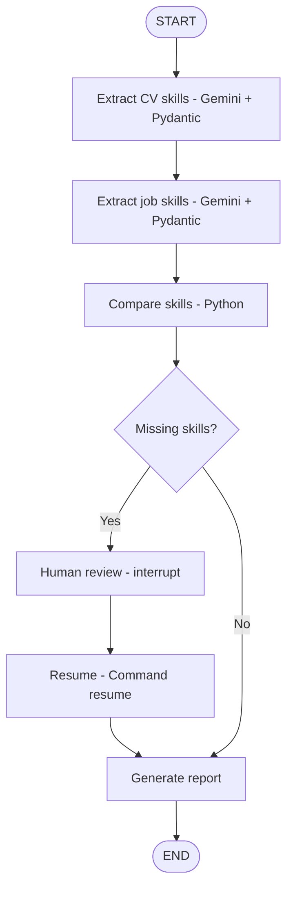

# Recruitment Skills Review Assistant

A small, reproducible AI engineering project built to learn **LangGraph** orchestration, **Gemini** structured extraction, and **human-in-the-loop** review. This is a learning prototype, not an automated hiring decision system.

## What it does

1. Accepts a CV and a job description as pasted text or text-based PDF files.
2. Extracts explicitly mentioned technical skills using Gemini with a Pydantic output schema.
3. Compares the skills using deterministic, case-insensitive string matching.
4. If required skills are not found in the CV, pauses the workflow for human review.
5. Resumes on approval or a request for revision, then displays a report.

**Important:** "Not identified" means a skill was not explicitly extracted from the CV. It does not prove that the person lacks that skill. Requesting a revision records a status; it does not automatically re-extract or modify the analysis.

## Architecture



The LangGraph **state** passes data between nodes. Conditional edges choose the route, and the in-memory checkpointer holds interrupted execution state while the Python process is running. Streamlit preserves the `thread_id` across interface interactions.

## Technology stack

| Technology | Role |
| --- | --- |
| Python 3.11 | Application logic |
| LangGraph | State, nodes, conditional edges, checkpoints, human-in-the-loop |
| LangChain Google GenAI + Gemini | Structured skill extraction |
| Pydantic | Validation of the structured LLM response |
| Streamlit | Web UI, uploads, human review |
| pypdf | PDF text extraction |
| uv | Dependency and environment management |
| pytest | Automated unit and workflow testing |
| ReportLab | Generate test PDFs (development dependency only) |
| GitHub Actions | Run tests on push and pull requests |

## Quick start (Windows / PowerShell)

Requirements: Git, `uv`, and a Gemini API key from [Google AI Studio](https://aistudio.google.com/apikey).

```powershell
git clone https://github.com/djamelabbas/langgraph-recruitment-assistant.git
cd langgraph-recruitment-assistant
uv sync --locked
Copy-Item .env.example .env
```

Edit `.env` and replace the placeholder with your own key:

```dotenv
GOOGLE_API_KEY=your_gemini_api_key
```

Launch the web app:

```powershell
uv run streamlit run app.py
```

You can also run the LangGraph demonstration in a terminal:

```powershell
uv run python main.py
```

**Do not commit `.env` or real candidate documents.** Uploaded document text is sent to the external Gemini API. Only use synthetic test data for this public demo.

## Automated testing

```powershell
uv run python -m pytest -q
```

**Local result: 14 tests passed (Python 3.11, Windows).** The tests use mocks for the Gemini extraction calls and do not require an API key.

| Scope | Tests |
| --- | ---: |
| Skill comparison, routing, report generation | 7 |
| LangGraph interrupt/resume and no-review route | 3 |
| Valid, empty, oversized, and invalid PDFs | 4 |
| **Total** | **14** |

The GitHub Actions workflow (`.github/workflows/tests.yml`) is configured to run these tests on pushes and pull requests targeting `main`. Its remote execution must be verified after publication.

## Files

```text
.
|-- .github/workflows/tests.yml   # Continuous integration
|-- .streamlit/config.toml        # Upload size limit
|-- tests/
|   |-- test_workflow.py          # Unit tests
|   |-- test_graph.py             # LangGraph HITL tests
|   `-- test_pdf.py               # PDF tests
|-- .env.example                  # API key template
|-- .python-version
|-- app.py                        # Streamlit application
|-- extract.py                    # Gemini + Pydantic extraction
|-- main.py                       # LangGraph definition and CLI demo
|-- pdf_utils.py                  # PDF extraction helper
|-- pyproject.toml                # Project dependencies
`-- uv.lock                       # Locked dependencies
```

## Limitations and next steps

- PDF input must contain selectable text; scanned documents need OCR.
- Files are limited to 5 MB; encrypted PDFs are not supported.
- Comparison uses exact skill names (ignoring case), not synonyms or semantic equivalence.
- Gemini output can be incomplete or inaccurate; Pydantic validates structure, not truth.
- The in-memory checkpointer does not persist workflows across app restarts.
- This tool does not rank candidates or automate recruitment decisions.

Potential extensions: editable human review, semantic skill mapping, durable checkpoint storage, and more thorough evaluation of extraction quality.

---

**Purpose:** a small public portfolio project demonstrating LangGraph orchestration and safe human review patterns, rather than a production HR application.
